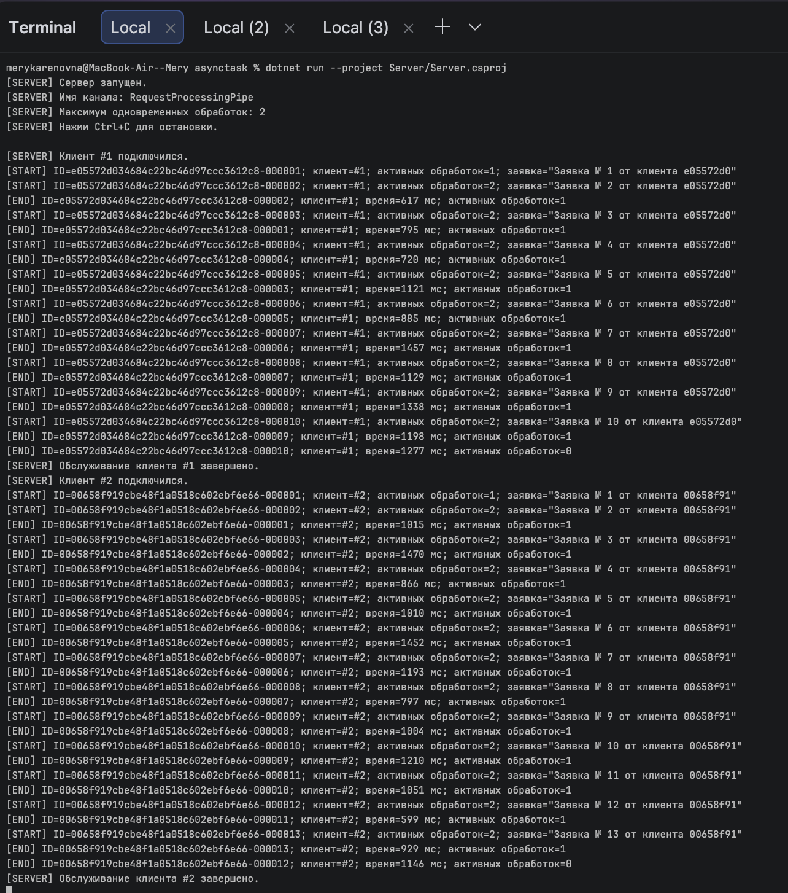
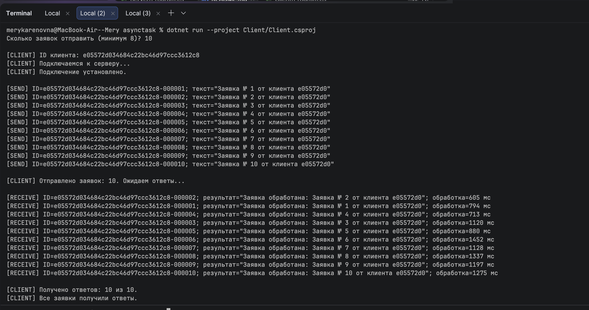
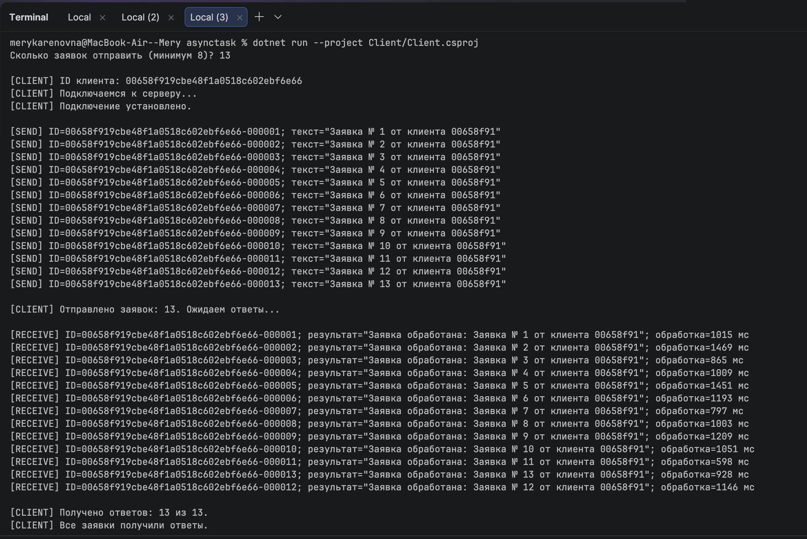

# Система обработки заявок

## Описание

Программа состоит из двух частей: клиента и сервера.

Клиент отправляет заявки серверу через именованный канал. Сервер обрабатывает заявки и отправляет клиенту ответы.

## Как работает программа

- Клиент отправляет не менее 8 заявок подряд, не ожидая ответа на каждую.
- Каждая заявка имеет уникальный номер.
- Сервер может работать с несколькими клиентами одновременно.
- Одновременно обрабатываются не более 2 заявок.
- Время обработки одной заявки составляет от 0,5 до 1,5 секунды.
- Сервер записывает в консоль начало и конец обработки каждой заявки.
- Клиент получает ответ с номером заявки, поэтому может понять, к какой заявке он относится.

## Запуск программы

Для начала нужно собрать проект. В терминале из папки проекта выполнить команду:

```bash
dotnet build RequestSystem.slnx
```

### Запуск сервера

В первом терминале выполнить:

```bash
dotnet run --project Server/Server.csproj
```

### Запуск первого клиента

Во втором терминале выполнить:

```bash
dotnet run --project Client/Client.csproj
```


При запуске нужно указать количество заявок — не меньше 8.

### Запуск второго клиента

В третьем терминале выполнить ту же команду:

```bash
dotnet run --project Client/Client.csproj
```



Так можно проверить работу сервера с двумя клиентами одновременно.

## Остановка сервера

Чтобы остановить сервер, нужно нажать `Ctrl+C` в терминале сервера. Сервер перестанет принимать новые подключения и завершит уже начатую обработку заявок.
=======
